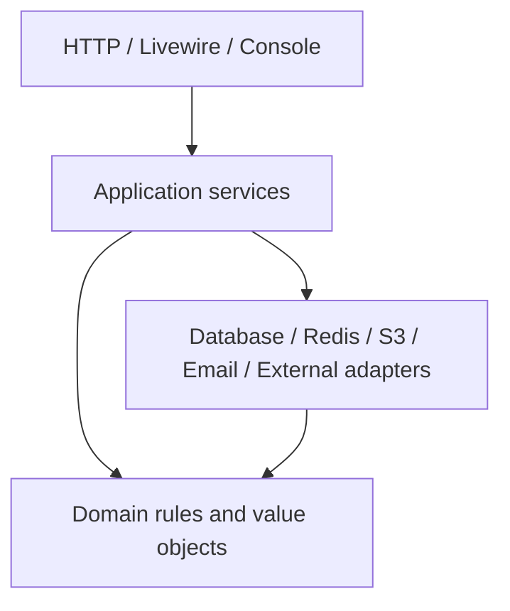

# Domain Boundaries

## 1. Aturan umum

- Controller dan Livewire component hanya menangani input/output, authorization entry check, serta orchestration tipis.
- Business rule berada pada domain/application service yang dapat diuji tanpa browser.
- Modul tidak mengakses tabel milik modul lain secara bebas. Gunakan public application service, query contract, ID/reference, atau domain event yang disetujui.
- Eloquent model tidak boleh menjadi lokasi seluruh workflow. State transition, scoring, publish, lock, dan correction menggunakan service eksplisit.
- Cross-module side effect penting memakai outbox. Event bukan alasan untuk membuat consistency yang seharusnya atomik menjadi eventual.

## 2. Dependency direction

Domain tidak boleh bergantung pada Laravel HTTP, Livewire, queue transport, filesystem vendor, atau external payload.

## 3. Ownership dan public contract

| Modul | Owns | Boleh memanggil | Dilarang |
|---|---|---|---|
| Identity & Access | User identity, role assignment, delegation | Organization scope lookup, audit | Mengubah score/actual |
| Organization | Hierarchy dan assignment effective-dated | Identity reference, audit | Mengubah histori snapshot periode |
| KPI Governance | Definition/version/template | Organization applicability, audit | Mengubah published version in-place |
| Period & Assignment | Period dan scorecard assignment snapshot | Organization dan template published | Mengikuti hierarchy current untuk periode lama |
| Target | Target/version | Period assignment, KPI version, workflow | Mengubah target final langsung |
| Actual & Evidence | Actual/version/evidence metadata | Target, period, KPI version, storage port | Menghitung score final di controller |
| Scoring | Strategy dan calculation snapshot | Target/actual/KPI immutable inputs | Membaca rule terbaru untuk periode historis |
| Workflow | Task/transition/calibration/correction | Policies, period, scoring, audit/outbox | Melompati transition atau self-approve |
| Team Review | Issue/action/coaching note | Organization scope, KPI reference | Menjadi HRIS leave system |
| Reporting | Scoped read/query/export | Public read contracts seluruh modul | Mem-bypass policy melalui query langsung |
| Notification | Preference/delivery | Outbox dan authorized deep-link contract | Menentukan business state |
| Audit | Audit event/query | Actor/scope metadata | Menjadi application debug log |
| Integration | Adapter/staging/reconciliation | Public commands/read contracts | Memasukkan vendor payload langsung ke domain |
| Unit Features | Specialized workflow/read model | Generic KPI contracts dan source adapters | Menggandakan generic KPI engine |

## 4. Aggregate dan transaction boundary

| Aggregate/use case | Boundary atomik |
|---|---|
| Publish KPI template | Version validation, total weight 100%, publish state, audit, outbox |
| Open period | Period state, assignment/approver snapshot, audit |
| Submit actual | Actual version, evidence linkage, approval task, audit, outbox |
| Approval transition | Current state check, decision, next task, audit, outbox |
| Calibration | Original value, calibrated value, reason, recalculation snapshot, audit |
| Period lock | Precheck result, eligible records, lock state, audit |
| Correction approval | Request decision, new data version, recalculation, audit |
| Import commit | Valid staged rows, source/idempotency keys, audit/control totals |

Export build dan notification delivery bukan bagian transaction utama; keduanya asynchronous dan dapat diulang secara idempotent.

## 5. Domain events minimum

- `KpiTemplatePublished`
- `PeriodOpened`
- `TargetApproved`
- `ActualSubmitted`
- `ActualVerified`
- `ScoreCalculated`
- `CalibrationCompleted`
- `FinalApprovalCompleted`
- `PeriodLocked`
- `CorrectionRequested`
- `CorrectionApproved`
- `CorrectiveActionOverdue`
- `ImportCommitted`
- `ExportCompleted`

Nama event adalah contract internal dan harus berversi bila payload digunakan lintas adapter. Jangan menerbitkan evidence content atau data sensitif yang tidak diperlukan.

## 6. Query boundaries

- Dashboard memakai query/read service yang selalu menerima actor scope.
- Auditor dapat membaca versi historis melalui read-only contract.
- System Admin health view tidak memperoleh akses nilai KPI sebagai efek samping.
- Report/export menyimpan filter dan scope snapshot pada saat request dibuat.
- Cache key wajib memasukkan tenant/company dan authorization scope yang relevan.

## 7. Extension rules

Fitur unit baru ditambahkan dengan urutan:

1. Tentukan apakah generic KPI actual/reference sudah cukup.
2. Jika butuh workflow khusus, buat module/read model terpisah.
3. Integrasikan ke score melalui approved metric-source contract.
4. Jangan menambahkan `if team_name == ...` pada generic scoring/workflow.

