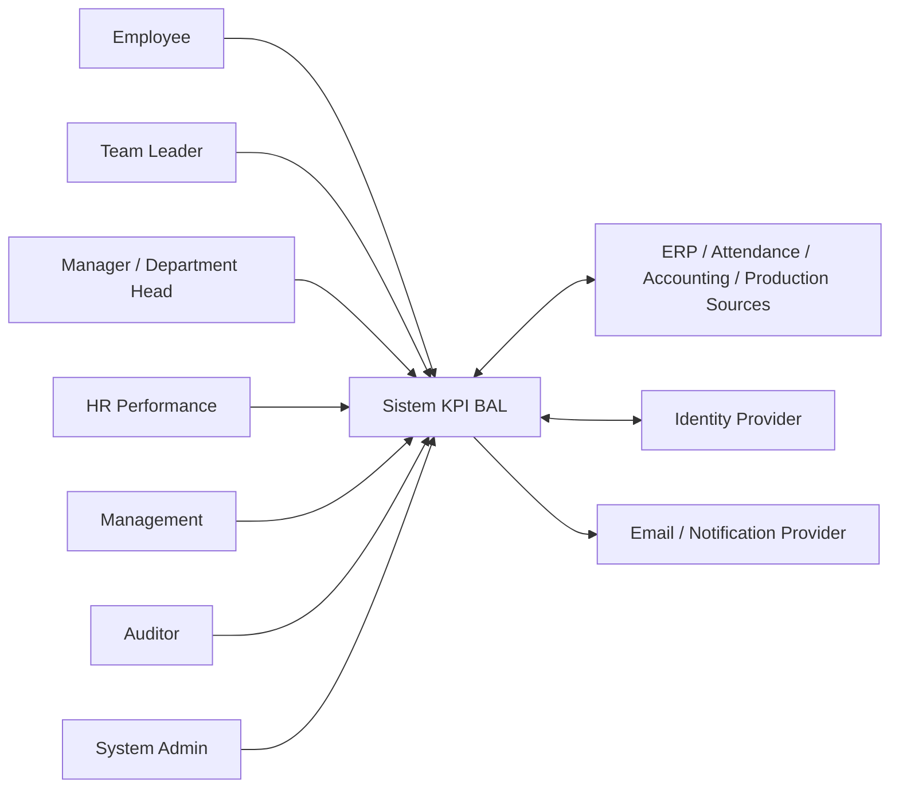
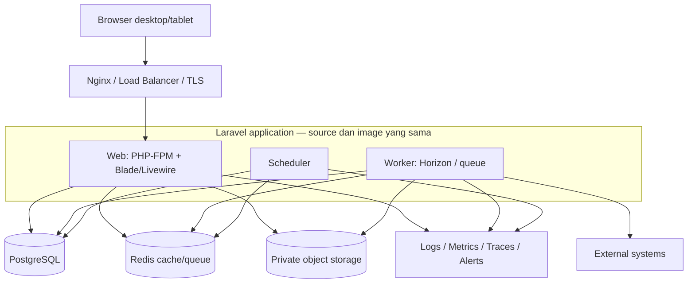
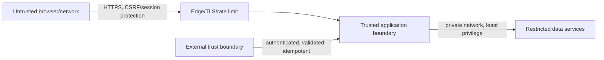
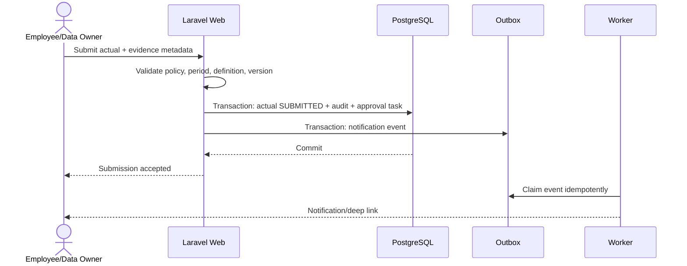
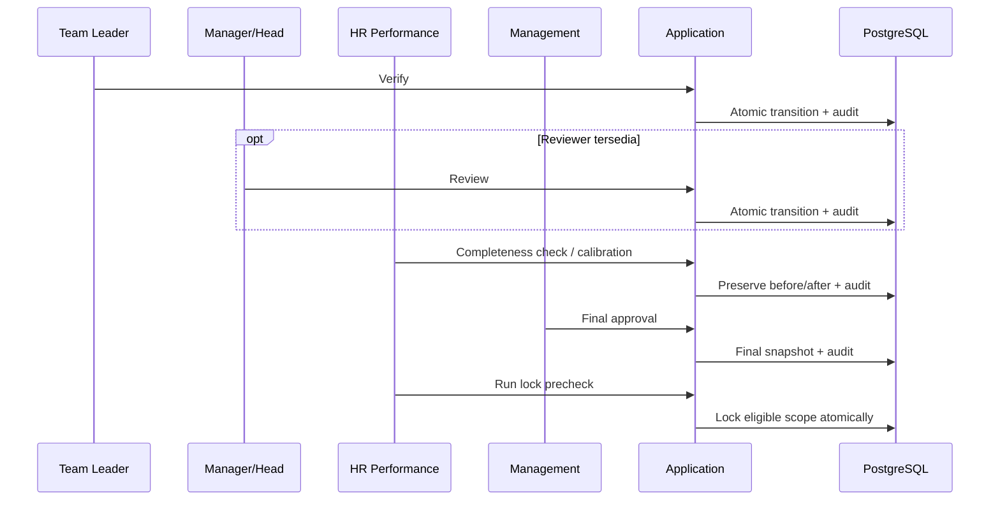
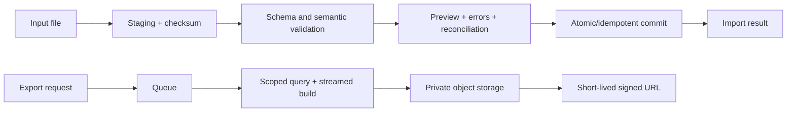

# Solution Architecture — Sistem KPI PT Berlian Artha Label

**Status:** Baseline arsitektur untuk review  
**Tanggal:** 12 Oktober 2026  
**Gaya:** Modular monolith, full-stack Laravel

## 1. Tujuan arsitektur

Arsitektur mendukung satu sumber data KPI yang dapat diaudit dari level company, group/department, team, sampai employee. Desain memprioritaskan konsistensi transaksi, transparansi perhitungan, organization-scoped authorization, versioning, dan operasi yang sederhana untuk tim pengembang kecil.

Keputusan bisnis yang masih `OPEN` pada `docs/product/DECISION_REGISTER.md` diperlakukan sebagai constraint. Kode tidak boleh mengubah placeholder menjadi aturan resmi.

## 2. System context



Sistem sumber tetap menjadi owner data operasionalnya. Sistem KPI menyimpan reference, snapshot, calculation, workflow, serta audit yang diperlukan untuk penilaian; sistem KPI tidak menggantikan ERP, HRIS, accounting, MES, atau WMS.

## 3. Container view



Ini adalah satu deployable application dengan beberapa runtime process. Database, Redis, object storage, dan observability merupakan service terpisah.

## 4. Module map

| Modul | Tanggung jawab utama | Data yang dimiliki |
|---|---|---|
| Identity & Access | Login/SSO adapter, session, roles, scope, delegation | User, role assignment, delegation |
| Organization | Company, department/group, team, employee assignment, shift, hierarchy effective date | OrganizationUnit, Employee, EmployeeAssignment |
| KPI Governance | Definition, version, template, weight, applicability, publish/retire | KPIDefinition, KPIVersion, KPITemplate |
| Period & Assignment | Period lifecycle, deadline, scorecard subject/approver snapshot | EvaluationPeriod, ScorecardAssignment |
| Target | Target input/import, version, approval reference | Target, TargetRevision |
| Actual & Evidence | Actual entry/import, completeness, source reference, evidence metadata | Actual, ActualVersion, Evidence |
| Scoring | Strategy, deterministic calculation, immutable snapshot, aggregation | CalculationSnapshot, Score, RatingResult |
| Workflow | Verification, review, calibration, final approval, lock, correction/reopen | ApprovalTask, Calibration, CorrectionRequest |
| Team Review | Daily review, issue, corrective action, coaching note | TeamReview, CorrectiveAction, CoachingNote |
| Dashboard & Reporting | Role dashboard, report query, asynchronous export | ReportRequest, ExportArtifact |
| Notification | Reminder, escalation, preference, delivery attempt | Notification, DeliveryAttempt |
| Audit | Business audit query and retention policy | AuditEvent |
| Integration | Staging, adapter, batch, idempotency, reconciliation, outbox | IntegrationRun, ImportBatch, OutboxMessage |
| Unit Features | PPIC, AR aging, production dimensions, NCR/CAPA | Read models dan workflow khusus yang disetujui |

Module boundaries dijelaskan pada `DOMAIN_BOUNDARIES.md`.

## 5. Data ownership dan consistency

- PostgreSQL adalah source of truth aplikasi KPI.
- Redis hanya cache, lock, rate limiting, dan queue transport; kehilangan Redis tidak boleh menghilangkan business record final.
- Binary evidence/export berada di private object storage; PostgreSQL menyimpan metadata, checksum, classification, owner, status scan, dan object key.
- Published KPI version, calculation snapshot final, approval decision, dan audit event bersifat immutable secara logis.
- Submit, approval, calibration, correction, lock, dan calculation snapshot memakai transaction boundary eksplisit.
- Side effect penting dikirim melalui transactional outbox dan worker idempotent.
- Nilai presisi memakai decimal/numeric, bukan floating point.

## 6. Trust boundary



Kontrol utama:

- authorization diperiksa pada server untuk setiap route, Livewire action, file, export, job, dan transition;
- role selalu digabungkan dengan organization scope dan effective assignment;
- self-approval dilarang dan delegation tidak boleh memperluas scope;
- upload masuk quarantine sampai validation/scan selesai;
- secret hanya dari environment/secret manager dan diredaksi dari log/audit;
- export dan signed URL mempunyai scope, expiry, serta audit bila sensitif.

## 7. Alur utama

### 7.1 Submit actual



### 7.2 Approval sampai lock



### 7.3 Correction

```mermaid
sequenceDiagram
    actor R as Requester
    participant A as Application
    participant P as Authorized Approver
    participant D as PostgreSQL

    R->>A: Request correction with old/proposed/reason/evidence
    A->>D: Save request + audit; original remains final
    P->>A: Approve/reject correction
    A->>D: If approved, create new version + recalculate + link audit
    A-->>R: Decision and resulting version
```

### 7.4 Import dan export



## 8. Deployment topology

### Development

Docker Compose menjalankan Nginx, Laravel web, Horizon worker, scheduler, PostgreSQL, Redis, S3-compatible storage lokal, dan mail catcher. Data development tidak boleh berasal dari production tanpa sanitasi/approval.

### Pilot/staging

- environment dan secret terpisah;
- immutable image dari CI;
- managed PostgreSQL/object storage bila tersedia;
- integration sandbox atau controlled file import;
- monitoring, alert, backup, dan restore rehearsal wajib;
- email diarahkan ke safe recipients sebelum UAT.

### Production

Desain provider-neutral: load balancer/TLS → minimal dua web instances jika SLA menuntut HA → worker pool → scheduler singleton/leader-safe → managed PostgreSQL → managed Redis → private object storage → centralized observability. Provider, region, RPO/RTO, dan sizing menunggu TECH-003/DEC-007/DEC-010/DEC-014.

## 9. Kebutuhan nonfungsional

| PRD NFR | Respons arsitektur |
|---|---|
| Transaction reliability | Database transaction, state guard, idempotency, outbox |
| Halaman standar 3 detik | Pagination, scoped indexes, query budget, cache aman, load test representatif |
| Availability | Stateless web, health/readiness, managed data service, documented maintenance |
| Asia/Jakarta | Timestamp konsisten dan explicit presentation timezone |
| Usability | Reusable form/table states, filter/search/sort/export |
| Desktop/tablet | Responsive Livewire/Blade layout dan browser E2E |
| Accessibility | Semantic HTML, keyboard/focus, label/error, non-color status |
| Observability | Structured log, metric, trace, scheduler/queue/integration heartbeat |
| Backup/recovery | Encrypted backup, retention, isolated restore rehearsal |
| Browser compatibility | Decision matrix dan Playwright browser gate sebelum UAT |

## 10. Risiko arsitektur

| Risiko | Mitigasi |
|---|---|
| Business rule belum final | Versioned configuration, decision gate, golden examples |
| Scope leak | Server-side policy + organization scope + negative tests |
| Race pada approval/lock | Atomic transition, lock/concurrency token, unique constraint |
| Duplicate import/integration | Source key, file hash, idempotency, reconciliation |
| Audit terlewati | Domain/application service transaction, bukan hanya UI observer |
| Query dashboard berat | Read-optimized queries, indexes, measured cache/materialization |
| File berbahaya | Private quarantine, validation, scan interface, signed URL |
| External outage | Retry bounded, dead-letter/manual recovery, freshness indicator |
| Redis kehilangan data | Business source tetap PostgreSQL; queue/outbox dapat direplay |

## 11. Keputusan yang tetap terbuka

Arsitektur belum mengunci identity provider, hosting/provider, exact HA topology, storage retention, RPO/RTO, integration protocol, capacity, atau production sizing. Semua mengikuti decision register dan harus diputuskan sebelum production design disetujui.

